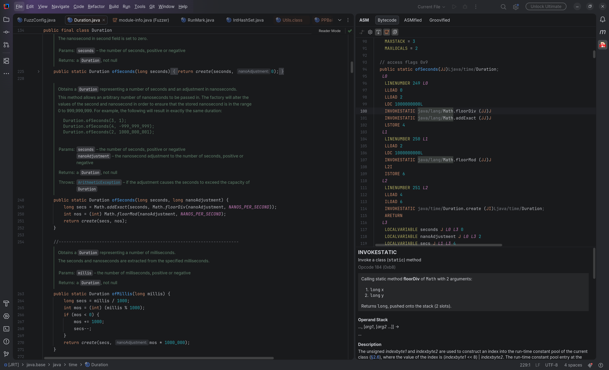

# ASM Bytecode Outline *(Rebooted)*

***

This is a fork of the original Intellij Plugin that has been abandoned.

## Getting the updated addon

1. It can be found on the jetbrains marketplace under the "Rebooted" name
2. You can get the plugin from the releases page
3. You can download the repo and build a jar with gradle

For any familiar with the old version from Eclipse or Intellij, it works the same as before, except the ASM has been updated as to support modern .class versions and the Intellij addon API has been kept up to date.
With **Follow Editor** enabled (the toggle in the Bytecode tab), the tool window shows the bytecode of whatever file you are editing, the bytecode generated from the source line under the caret is highlighted, and clicking in the bytecode highlights the source line it came from.

I am open to feature requests, but beyond this, the addon is mostly on maintenance mode. (except when it's not!)
The addon should work with the latest version of IntelliJ IDEA. If it does not, please open an issue about it! I may have forgotten to update it.

## Recent & original work

I've been wanting to improve upon this plugin for a long time, and it has finally been done.

There has been a significant upgrade of the plugin, bytecode lexing and text highlighting has been added. IDE integrations have also been significantly improved and most exciting, cursor can now
follow the editor and will automatically switch classes!

The plugin can now also open standalone class files and parse them. Editing is planned but not implemented.

***

### Thanks for reading this, and I wish you a happy bytecode inspection! 🎉

***
